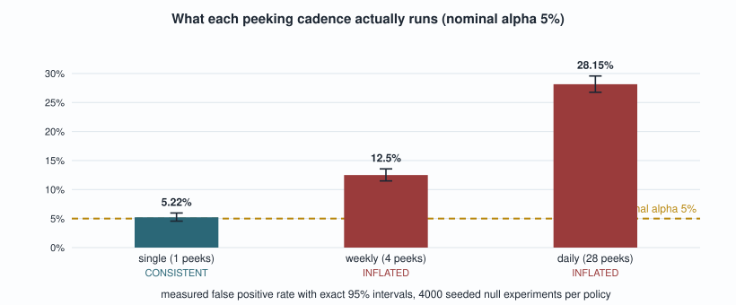
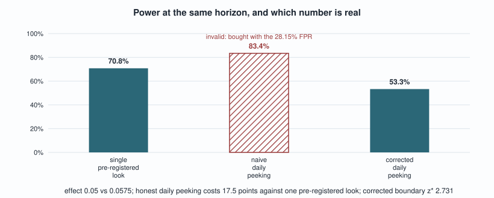
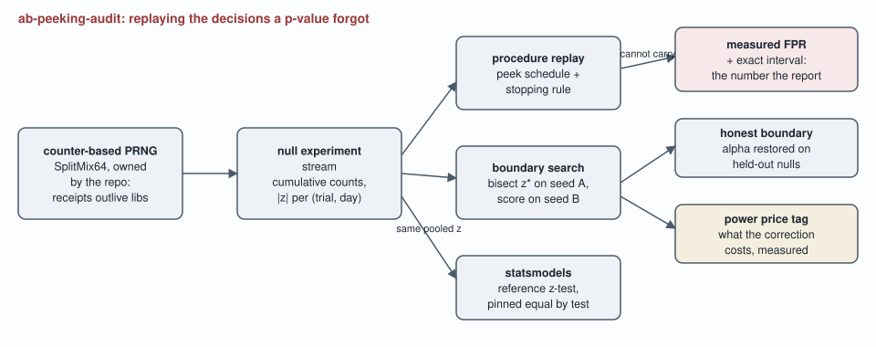

# ab-peeking-audit

**An A/B test procedure auditor: it replays decision procedures over seeded
null experiments and measures the false positive rate a final p-value
structurally cannot report, then calibrates the boundary that restores the
nominal alpha and prices what that honesty costs in power.**

[](https://github.com/lavanyag-wq/ab-peeking-audit/actions/workflows/ci.yml)

A reported p-value is a function of the final counts. The decision procedure
that produced it, how many times the dashboard was peeked at and whether a
significant peek stopped the experiment, is not in the counts, so the report
cannot reveal its own error rate no matter how carefully it is read: p = 0.03
reads identically whether it came from one pre-registered look or from the
daily peek that finally crossed the line. This tool supplies what the report
cannot carry: the procedure's measured false positive rate with an exact
interval, the decision log a report throws away, a simulation-calibrated
boundary that makes the same peeking schedule honest, and the measured power
that correction gives up.

## The numbers to read first

- **The same report, three different error rates.** At a nominal alpha of
  0.05, over 4000 seeded null experiments each: the single pre-registered
  look runs 5.22%, weekly peeking runs 12.5%, and daily peeking runs 28.15%
  false positives, exact intervals in the table below. The reported p-values
  overlap completely across procedures: daily-peeked null wins carry a
  median reported p of 0.0347 against a single-look median of 0.0252. Both
  read as "significant at 0.05"; one of them is wrong more than five times
  as often.
- **The wins themselves are vapor.** The daily-peek procedure stopped early
  in 1126 of the 4000 null experiments, at a median stop day of 5. Left to
  run to the planned horizon, 81.4% of them are no longer significant. The
  early stop is not detecting an effect; it is harvesting noise and then
  destroying the evidence by ending the experiment.
- **Honesty has a price, and it is measured.** The calibrated constant z* of
  2.731 (per-peek alpha of 0.00631) restores a held-out rate of 4.05%. At a
  real effect (0.05 against 0.0575), the single look wins 70.8%, naive daily
  peeking advertises 83.4% (bought with the 28.15% error rate), and honest
  daily peeking falls to 53.3%: the correction costs 17.5 points of power at
  the same horizon.

Credibility line: 74 tests, 100% line coverage, and every figure in this
document is re-measured by CI and matched against the prose by
`tools/check_numbers.py`. Break one number and the build fails.

## Quickstart

Prerequisites: Python `3.10` or newer; numpy, scipy, statsmodels (wheels, no
network or keys at runtime).

```bash
pip install -e ".[dev]"
peek-audit audit --policy daily ; echo "exit $?"
peek-audit boundary --policy daily --seed 11 --holdout-seed 12
peek-audit replay --policy daily --seed 42
make verify   # lint, 74 tests, experiments re-run, every published number re-checked
```

## What each procedure actually runs

One null design (28 days, 400 subjects per arm per day, base rate 0.05),
4000 seeded null experiments per policy, from `experiments/exp_inflation.py`:

| procedure | peeks | measured FPR | exact 95% CI | verdict |
| --- | ---: | ---: | --- | --- |
| single pre-registered look | 1 | 5.22% | [4.56%, 5.96%] | CONSISTENT |
| weekly peeking | 4 | 12.5% | [11.49%, 13.56%] | INFLATED |
| daily peeking | 28 | 28.15% | [26.76%, 29.57%] | INFLATED |

The audit's verdict is interval-based on purpose: INFLATED requires the
exact interval to exclude alpha from below, CONSISTENT requires it to rule
out a doubled rate, and anything in between exits 2 as INCONCLUSIVE with the
instruction "more trials", because a Monte Carlo rate quoted without its
resolution is a number wearing more precision than it has (ADR-004).

## The experiment the final report cannot describe

From `experiments/exp_identical_pvalue.py`, all under the null:

| reported p of null wins | q25 | median | q75 |
| --- | ---: | ---: | ---: |
| daily peeking (28.15% FPR) | 0.0235 | 0.0347 | 0.0427 |
| single look (5.22% FPR) | 0.0124 | 0.0252 | 0.0373 |

Same numbers on the page, error rates more than five times apart behind
them. Nothing on the page
distinguishes the two, which is the structural fact this repository is
built on: the procedure is not in the report, so the report cannot be
audited, only the procedure can. That is also why the tool's `replay`
command exists: it prints the decision log (every peek's statsmodels
p-value and both rules' stopping behaviour) that a result write-up throws
away, ending with the line "this number is all a report keeps".

## The correction and its price tag

From `experiments/exp_correction_cost.py`. The boundary is bisected on one
seed and scored on another, because a threshold measured on its own
calibration draws inherits their noise in its favour (ADR-002):

| procedure | threshold | valid | power at 0.05 vs 0.0575 |
| --- | ---: | :---: | ---: |
| single pre-registered look | 1.960 | yes | 70.8% |
| naive daily peeking | 1.960 | no | 83.4% |
| corrected daily peeking | 2.731 | yes | 53.3% |

The middle row is the seduction: peeking appears to add power. It is buying
detections with the same inflated alpha that produced 28.15% false
positives, so the extra wins are indistinguishable from the noise harvest
above. The honest comparison is row one against row three: daily peeking
with a valid boundary costs 17.5 points of power at this horizon
(11200 subjects per arm at the horizon; statsmodels puts the fixed-horizon
requirement for 80% power at this effect at 14178 per arm). A boundary that
spends alpha late (O'Brien-Fleming) would reclaim part of that cost; the
measurement to score it is already in place, and ADR-002 states what the
constant boundary leaves on the table.

## Measured, drawn

Rendered by `tools/render_charts.py` straight from the experiment JSON; CI
regenerates both charts and fails on any drift, the same contract the prose
lives under.





## The bugs the build found

The simulator's first counter layout generated a covering uniform range per
trial, which made 2000 trials take 82 seconds; the (day, arm)-major layout
in its own commit generates each block with one call and runs 4000 trials in
about two seconds. The number that revealed it was the wall clock, and the
fix is a layout, not an optimization flag: counter-based streams make the
layout part of the sample's definition, so the docstring now states that the
sample is a function of (seed, trials, design).

The PRNG pin test failed on first run: the expected known draw had been
written from memory instead of from the generator. A pinned value that was
never read from the machine is exactly the receipts failure this repository
exists to prevent, caught in the smallest possible place.

## Architecture



Generated by `tools/render_diagram.py`, committed so it renders identically
on GitHub and offline.

## Evidence

Real output (captured verbatim; reproduce with the quickstart commands):

```text
$ peek-audit audit --policy daily
policy: daily (28 peeks over 28 days)
measured false positive rate: 0.2815 [0.2676, 0.2957] exact 95% interval, 4000 null trials
nominal alpha: 0.05
verdict: INFLATED
$ echo "exit $?"
exit 1
```

## What this repository cannot establish

- **Any real experiment's error rate.** The audit measures procedures over
  simulated Bernoulli streams; a real experiment's peeking history is
  usually unrecorded, which is the impossibility itself. What the tool
  offers a real team is prospective: declare the schedule, audit it, and run
  with the calibrated boundary.
- **The cheapest honest correction.** The constant boundary is the simple
  valid procedure, not the optimal one; its 17.5 point cost is an upper
  bound on the price of honest daily peeking at this design (ADR-002).
- **Effects on non-binomial metrics.** Everything here is two-proportion;
  continuous metrics change the statistic, not the argument.
- **PRNG quality beyond the literature.** SplitMix64's test-battery results
  are cited, not re-proven; the suite checks gross properties and pins one
  known draw (ADR-001).

## Layout, exit codes, reproduction

```
src/ab_peeking_audit/   rng, simulate, audit, boundary, analysis, cli
tests/                  74 property-named tests, two of them pins
experiments/            inflation, identical p-value, correction cost
tools/                  collect_metrics, check_numbers, render_diagram
docs/adr/               four decision records
docs/experiments/       JSON the experiments wrote; CI regenerates it
```

Exit codes of `peek-audit audit`: **0** CONSISTENT (the exact interval is
compatible with alpha and rules out a doubled rate), **1** INFLATED (the
interval excludes alpha from below: the procedure provably lies), **2**
INCONCLUSIVE (the interval contains alpha but cannot exclude twice alpha:
run more trials), **3** error, never confused with a finding.

Make targets: `lint`, `test`, `experiments`, `receipts`, and `verify`, which
runs all of them from a fresh clone with no network. The number checker
matches anchor phrases rather than bare digits, because a digit match passes
while the sentence around it goes stale.

## Tech stack

| technology | role here | why this one |
| --- | --- | --- |
| SplitMix64 (own, 20 lines) | every random draw | receipts outlive library version policies; counter-based, one draw pinned by test (ADR-001) |
| numpy | vectorized counts and z over (trial, day) | the audit evaluates the test at every cell; per-cell Python calls would shrink trial budgets and widen every interval |
| statsmodels | reference z-test, power and sample-size context | the engine is pinned equal to proportions_ztest by test, so the Monte Carlo measures the test teams actually run (ADR-003) |
| scipy | normal and beta tails | critical values and exact Clopper-Pearson intervals |
| pytest + coverage | 74 tests, 100% line coverage | band assertions for Monte Carlo quantities, exact pins for the PRNG and the z equivalence |
| ruff | lint in CI | one tool, one config, line length actually held |

ADRs: [counter-based PRNG](docs/adr/ADR-001-counter-based-prng.md),
[simulated boundary with holdout](docs/adr/ADR-002-simulated-boundary.md),
[statsmodels as reference](docs/adr/ADR-003-statsmodels-as-reference.md),
[audit verdicts](docs/adr/ADR-004-audit-verdicts.md).

## The pivot, and future work

Intentionally out of scope: ingesting a real experiment platform's event
log. The trigger is owning a platform whose peek history is actually
recorded (assignment and analysis timestamps), at which point the audit runs
on real schedules instead of named ones.

Future work: an O'Brien-Fleming and alpha-spending option scored by the same
held-out audit, so the power reclaimed over the constant boundary becomes a
measured number; sequential tests for continuous metrics; always-valid
inference (confidence sequences) as a third procedure class; and a trend
mode over an organization's declared schedules. First metric to watch: the
share of audited schedules exiting 1.
